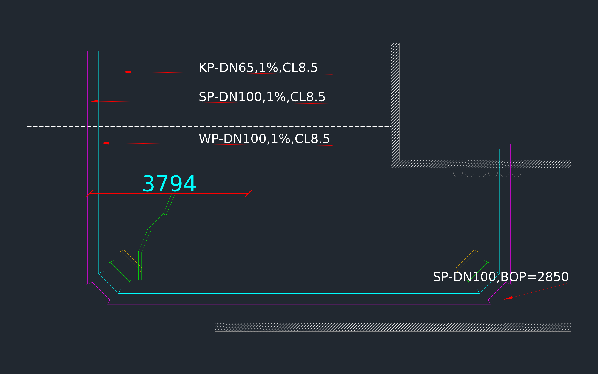

# 給排水管線平面圖（Python 自動繪製）

用 Python + [ezdxf](https://ezdxf.mozman.at/) 畫出類似 AutoCAD 的 MEP 給排水平面圖。



## 執行方式

```bash
pip install ezdxf matplotlib
python3 plumbing_drawing.py
```

會產生：

| 檔案 | 用途 |
|---|---|
| `plumbing_plan.dxf` | 用 AutoCAD / DWG TrueView / LibreCAD 開啟，可再另存成 `.dwg` |
| `plumbing_plan.png` | 深色底預覽圖 |

## 圖層與顏色

| 圖層 | 顏色 | 內容 |
|---|---|---|
| `P-SP-SOIL` | 洋紅 | SP 污水管 DN100 |
| `P-WP-WASTE` | 青色 | WP 廢水管 DN100 |
| `P-KP-KITCHEN` | 綠色 | KP 廚房排水管 DN65 |
| `P-VP-VENT` | 橘色 | VP 通氣管 DN65 |
| `A-WALL` / `A-HATCH` | 灰色 | 牆、斜線填充 |
| `S-GRID` | 白色點鏈線 | 柱線 |
| `P-LEADER` / `P-DIM` | 紅色 | 引線、尺寸標註 |

## 想改成自己的圖

- 改 `PIPES`：增減管線、換顏色或管徑
- 改 `draw_pipes()` 裡的 `corners`：管線的轉折點座標（單位 mm）
- 改 `CHAMFER`：45° 彎頭的長度
- 改 `draw_labels()`：標註文字（例如 `SP-DN100,1%,CL8.5`）
